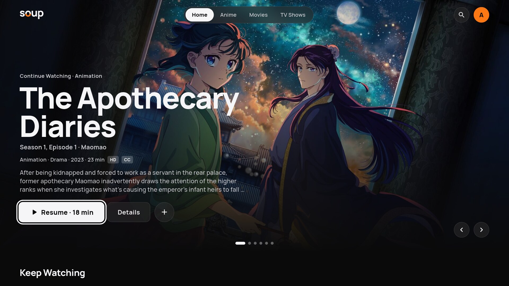
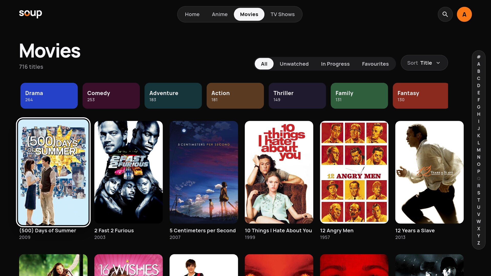
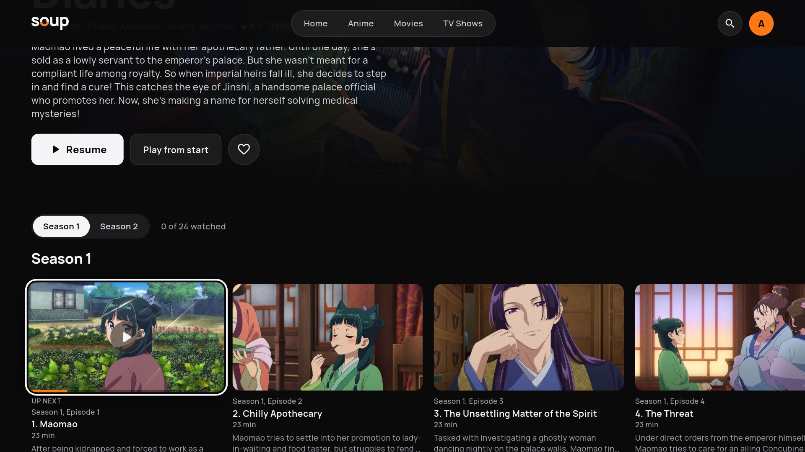
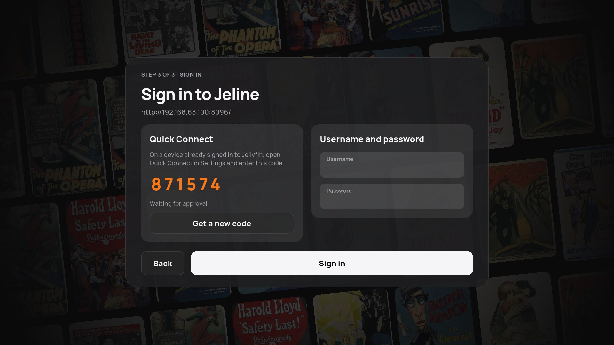

# Soup

A Jellyfin client for the browser and the TV, with an optional way to let friends
sign in with their Google account instead of a Jellyfin password.



| Sign in | Movies | Episodes |
| --- | --- | --- |
|  |  |  |

## How it fits together

| Piece | What it is | Needed for |
| --- | --- | --- |
| **Web app** (`apps/web`) | Static site you host anywhere; runs entirely in the browser | Watching in a browser |
| **TV app** (`apps/android-v2`) | Android TV app (also builds for LG webOS) | Watching on a TV |
| **Jellyfin plugin** (`plugins/jellyfin-soup`) | Adds Soup sign-in and an invite list to your Jellyfin | Google sign-in |
| **Soup Identity** (`services/soup-identity`) | Small Node + Postgres service that handles Google sign-in | Google sign-in |
| **Tailscale** (optional) | Private network so guests can reach a Jellyfin that isn't on the internet | Remote guests |

There are two ways to sign in, and you can use both:

- **Direct:** enter your Jellyfin address, then sign in with Quick Connect or a
  username and password. Only Jellyfin is involved, so nothing else needs setting up.
- **Sign in with Soup:** the TV shows a QR code, the guest scans it, signs in
  with Google, and they're in. The server owner invites guests by email
  from the Jellyfin dashboard. This needs Soup Identity and the plugin.

## 1. Try it without any servers

Both apps have a mock mode with a built-in sample library.

```sh
# Web: http://localhost:3000, signed in automatically
task web:deps && task web:dev:mock

# TV app on an emulator or device (see "Build the TV app" below)
task v2:run DEVICE=emulator-5554 -- --dart-define=SOUP_MOCK=true
```

## 2. Use Soup with your Jellyfin (direct sign-in)

You need a Jellyfin server the device can reach.

**Web app**

1. In Jellyfin, go to **Dashboard → Networking** and allow the web app's address
   as a CORS origin (e.g. `http://localhost:3000`, or wherever you host it).
2. Run it locally, or build it and host the files:

   ```sh
   cd apps/web
   cp .env.example .env
   npm install
   npm run dev          # local: http://localhost:3000
   npm run generate     # hosting: upload .output/public to any static host
   ```

3. Open it. Under **or connect to a Jellyfin server**, pick your server or enter
   its address, then use Quick Connect or your username and password.

If you host it on `https://`, the browser will block calls to an `http://`
Jellyfin, so put Jellyfin behind HTTPS (or a Tailscale `https://…ts.net` name).
Hosting details, including SPA fallback and the editable `soup.config.json`, are in
the [web app README](apps/web/README.md).

**TV app**

Install the APK (see [Build the TV app](#build-the-tv-app)), open Soup, pick your
server from the list it finds on your network (or **Enter address**), then sign in
with Quick Connect or a username and password.



## 3. Let guests sign in with Google

This is for sharing your library without handing out Jellyfin passwords. The guest
signs in with Google, Jellyfin trusts Soup Identity's signed confirmation of who they
are, and the plugin signs them in to their own Jellyfin user.

### a. Run Soup Identity

It's a Node 20+ service backed by Postgres 16. Phones must be able to open it, so
in production give it a public HTTPS address behind a reverse proxy.

**To try it locally**, `docker compose up -d --build` in `services/soup-identity`
starts it on `:8787` with Postgres. The compose file hard-codes development
settings (dev login on, placeholder secrets) that override `.env`, so don't use it
for a real deployment.

**For a real deployment:**

```sh
cd services/soup-identity
cp .env.example .env        # then edit, see below
npm ci && npm run build
npm start                   # applies database migrations on boot
```

In `.env`, set at least:

| Setting | Value |
| --- | --- |
| `DATABASE_URL` | Your Postgres connection string |
| `PUBLIC_BASE_URL` | The address phones will open, e.g. `https://identity.example.com` |
| `GOOGLE_CLIENT_ID` / `GOOGLE_CLIENT_SECRET` | From a Google Cloud **Web application** OAuth client |
| `GOOGLE_REDIRECT_URI` | `<PUBLIC_BASE_URL>/auth/google/callback`, also added to the OAuth client |
| `BOOTSTRAP_PLUGIN_ID` / `BOOTSTRAP_PLUGIN_SECRET` | A username and password the Jellyfin plugin will use |
| `TRANSPORT_GRANT_ENCRYPTION_KEY` | 64 random hex characters (`openssl rand -hex 32`) |
| `ALLOW_DEV_LOGIN` | `false` (`.env.example` has `true` for local testing) |

Check it with `curl https://identity.example.com/healthz`. The service keeps its
signing keys in `data/`, so back that folder up; losing it signs everyone out.
The [Soup Identity README](services/soup-identity/README.md) has the Google
Console steps, and `services/soup-identity/deploy/ploi/` has a process-manager
and nginx setup you can copy.

### b. Install the Jellyfin plugin

The plugin targets Jellyfin 10.11. Build it and copy it into Jellyfin's plugins folder:

```sh
cd plugins/jellyfin-soup
./scripts/stage-plugin.sh     # needs the .NET 9 SDK; output in docker/plugin/
```

Copy the contents of `docker/plugin/` into a new folder in your Jellyfin `plugins`
directory (e.g. `plugins/Soup Auth_0.1.0.0/`) and restart Jellyfin. To try it out first,
`task jellyfin:up` starts a throwaway Jellyfin on `http://localhost:8096` with the
plugin already installed.

### c. Connect the plugin to Soup Identity

In Jellyfin, open **Soup Invites** from the dashboard menu, then **Settings**
(top right):

1. **Soup base URL:** your Soup Identity address.
2. **Plugin id / secret:** the `BOOTSTRAP_PLUGIN_ID` / `BOOTSTRAP_PLUGIN_SECRET` from step a.
3. **Server id** and **Audience:** any stable name, e.g. `home` and `jellyfin:home`.
4. **Assertion issuer:** Soup Identity's `ASSERTION_ISSUER` (default `https://soup.local/identity`).
5. Save, go back to **Invites**, and select **Register server**.

### d. Invite a guest

On **Soup Invites**, invite the guest's **Google email address**. It must match
the Google account they'll sign in with. To use an existing Jellyfin user, put
its name in **Jellyfin username hint**; otherwise the plugin creates a user for
them the first time they sign in.

### e. Guest signs in

On the TV, the guest opens Soup and scans the QR code with their phone (or opens
the address shown and types the code). On the phone they tap **Continue with
Google**, and the TV signs itself in. The web app's sign-in page has the same QR
code, plus a **Continue with Google** button for signing in on that computer.

Point the apps at your Identity: in the web app, **Settings → General → Identity
server** (or `soupIdentityBaseUrl` in `soup.config.json`); for the TV app, build with
`--dart-define=SOUP_IDENTITY_BASE_URL=https://identity.example.com`.

### f. Optional: Tailscale for remote guests

If your Jellyfin isn't on the internet, the plugin can give each invited guest a
single-use Tailscale key, and the TV app joins your tailnet on its own; there's no
separate VPN app. Add a Tailscale OAuth client and guest tag in the plugin's
Settings. See the [plugin README](plugins/jellyfin-soup/README.md) for the
Tailscale setup and the access rules to add to your tailnet.

## Build the TV app

You need Flutter, the Android SDK and NDK, Go (for the embedded Tailscale library)
and [Task](https://taskfile.dev/).

```sh
task setup                                  # submodules + dependencies
task v2:build                               # debug APK
task v2:install DEVICE=<adb-serial>         # build and install on a device/emulator
task emulator:tv:start                      # boot an Android TV emulator
```

LG webOS builds run in Docker; see the [TV app README](apps/android-v2/README.md#webos).

## Repository layout

| Path | Contents |
| --- | --- |
| `apps/web` | Web app (Nuxt) |
| `apps/android-v2` | TV app (Flutter, Android TV and webOS) |
| `apps/android` | Legacy Android app, to be retired; new work goes in `apps/android-v2` ([README](apps/android/README.md)) |
| `services/soup-identity` | Soup Identity service |
| `plugins/jellyfin-soup` | Jellyfin plugin |
| `packages/` | Shared Dart code: `soup_core`, `soup_identity`, `soup_tailscale` (Tailscale FFI), `jellyfin_api` (generated) |
| `docs/` | Design notes, branding, development reports, screenshots |

## Development

```sh
task --list   # every task, with descriptions
task qa       # format check, analysis and tests across the Dart packages
```

- Web app: `task web:dev`, `task web:typecheck`.
- Soup Identity: `npm test` in `services/soup-identity` (needs its Postgres running).
- Jellyfin API bindings: `./tool/generate_jellyfin_api.sh` regenerates `packages/jellyfin_api`.
- Android emulator setup and limited-memory builds: [headless Linux setup](docs/development/android-linux.md).
